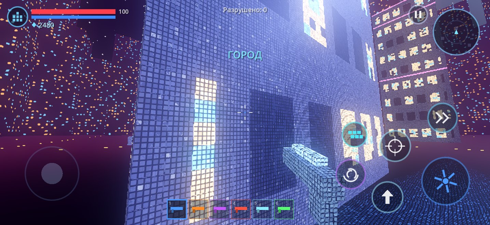
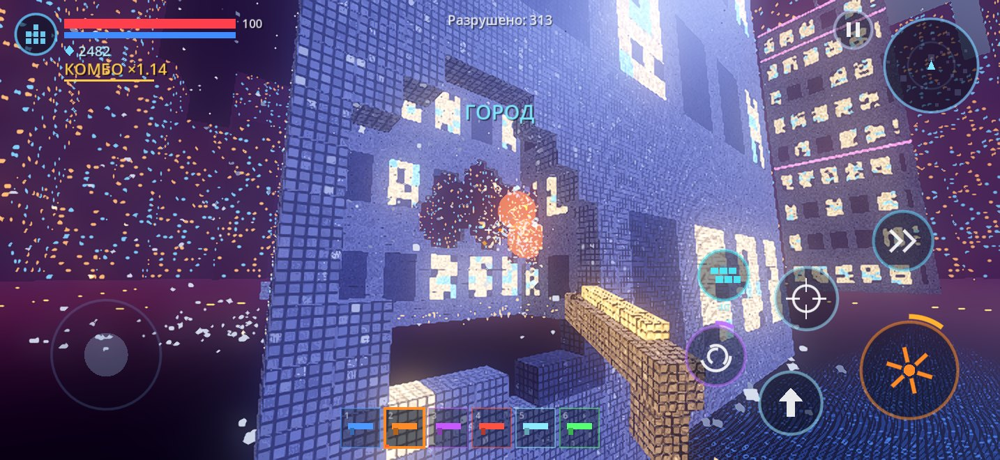
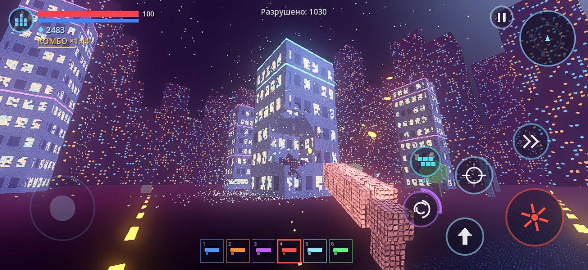
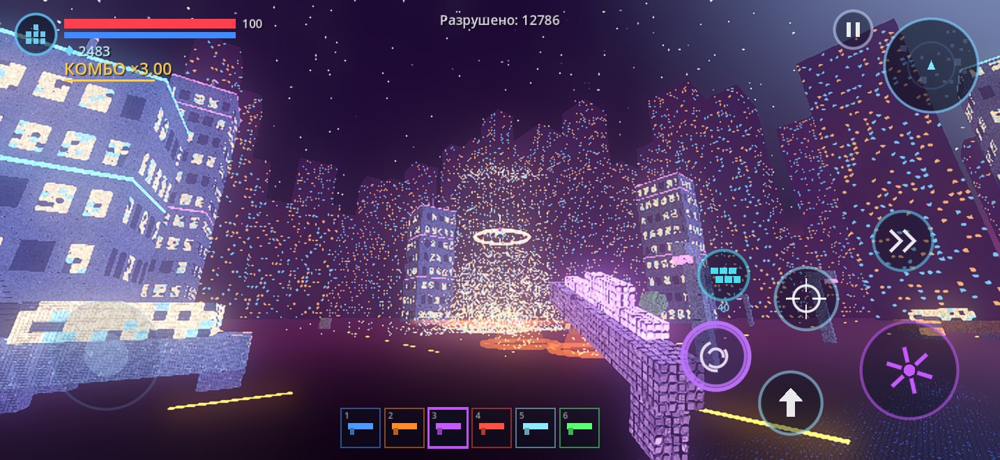

# Particle Strike

Мобильный 3D-шутер на Godot 4 **от первого лица**. Весь мир состоит из мелких частиц, и всё в нём можно разрушить. Проект сделан для **Xogot** на iPhone, оптимизация настроена под **iPhone 16 Pro Max**.

Текущая версия: одна локация (ночной неоновый **Город**), без волн врагов. Это песочница разрушений: стреляй, обрушивай небоскрёбы, собирай частицы, улучшай оружие.

Ассетов нет: модели, звуки, музыка, небо и земля генерируются кодом.

## Скриншоты (настоящий рендер, Mobile-рендерер Godot 4.4)

| | |
|---|---|
|  |  |
| Стена вблизи: каждая ячейка — сетка частиц по 5 см | Дробовик выбивает дыры, мелкие обломки летят |
|  |  |
| Ракетница по небоскрёбу | Небоскрёб рассыпается облаком частиц |

---

## Как запустить в Xogot (iPhone)

1. Скачайте `ParticleStrike.zip` и сохраните в «Файлы».
2. Нажмите на архив, и iOS распакует его в папку `particle_strike`.
3. В Xogot выберите **Open / Import Project** и откройте папку `particle_strike`, где лежит `project.godot`.
4. Дождитесь импорта и нажмите **▶ Play**.

Совместимость: Godot **4.4+**, рендер Mobile, только GDScript, без плагинов.

---

## Частицы: что изменилось

- **Видимые частицы — 5 см** (раньше 50 см, то есть в 10 раз мельче). Шейдер рисует каждую ячейку как сетку мелких частиц с зазорами и мерцанием.
- **Разрушение идёт ячейками по 25 см**, вдвое мельче прежнего. Дыры точнее, обрушения детальнее.
- **Обломки тоже 5 см.** Разрушенная ячейка рассыпается на несколько мелких частиц, а большой взрыв даёт тысячи частиц. Вся их физика считается на видеокарте.
- Почему не 5-сантиметровые кубы целиком: при тех же зданиях их было бы в сотни раз больше (десятки миллионов), и ни один телефон их не потянет. Сейчас в городе около **225 тыс. ячеек**, на экране это **миллионы видимых частиц**.

## Управление (только от первого лица)

| Где | Что делает |
|---|---|
| Левая половина экрана | Плавающий джойстик движения |
| Правая половина, свайп | Поворот камеры |
| **ОГОНЬ** | Стрельба; не отпуская кнопку, можно вести прицел |
| **ПРИЦЕЛ** | Приближение (у снайпера — оптика) |
| **ПРЫЖОК** | Повторное нажатие в воздухе — двойной прыжок |
| **РЫВОК** | Бросок с неуязвимостью |
| **ВИХРЬ** | Гравивихрь (заряжается от разрушений) |
| **СТЕНА** | Укрытие из частиц за 40 ◆ |
| Нижняя панель | 6 видов оружия |
| **II** | Пауза: улучшения, настройки, выход |

Клавиатура: WASD, стрелки — обзор, Пробел, Shift — рывок, Enter — огонь, R — прицел, 1–6 — оружие, Q — вихрь, E — стена, Esc — пауза.

Вид от первого лица анимирован:
- покачивание камеры и оружия при беге;
- приседание камеры при приземлении;
- инерция оружия при повороте;
- отдача;
- расширение обзора при рывке;
- тряска от взрывов.

## Механики

- **Разрушаемость.** Прочность зависит от материала: бетон, стекло, металл, дерево.
- **6 видов оружия:**

| Оружие | Стихия | Особенность |
|---|---|---|
| Пистолет | энергия | цепная молния |
| Дробовик | взрывные | 8 взрывающихся дробин |
| Снайпер | лазер | прожигает тоннель 6 м |
| Ракетница | фрагменты | большой взрыв и осколки |
| Ледяное | заморозка | превращает стены в хрупкий лёд |
| Плазма | разрушение | сфера проедает всё на своём пути |

- **Структурное обрушение.** Если перебить низ небоскрёба по кругу, верх падает целиком и разбивается в облако частиц.
- **Каскады и цепные взрывы.** Упавший кусок крушит всё под собой. Машины и бочки взрываются цепочкой.
- **Огонь** распространяется по деревьям, **лёд** делает стены хрупкими.
- **Сбор частиц-ресурсов** магнитом и **комбо-множитель** до ×3.
- **Перегрев** оружия вместо патронов.
- **Гравивихрь и стена** из частиц.
- **Улучшения:** персонаж (здоровье, щит, скорость, магнит, рывок, вихрь) и оружие (урон, радиус, темп, охлаждение).
- **Окружение и звук:** вибрация, эмбиент-музыка, подсказки при первом запуске.
- **Волны врагов пока отключены.** Код врагов и волн сохранён (`enemy.gd`, `wave_director.gd`), включить их — пара строк в `main.gd`.

---

## Оптимизация под iPhone 16 Pro Max

- **Частицы в шейдере.** Одна ячейка = 1 экземпляр MultiMesh, а 25 видимых частиц на каждой грани рисует фрагментный шейдер. Вдали узор плавно сливается, без муара.
- **Куб из 8 вершин** вместо 24: нормали считает шейдер. Втрое меньше работы вершинного конвейера.
- **Один MultiMesh на объект** (1 draw call), удаление ячейки — нулевой масштаб.
- **Буфер в памяти.** Крупные разрушения обновляют буфер одной загрузкой, а не тысячами вызовов.
- **Обрушение целого здания** превращает его в падающее тело, переиспользуя буфер частиц: меньше 3 мс вместо прежних ~37 мс.
- **Проверка опор не чаще раза в 0,25 с на здание.** При непрерывной стрельбе нет лишней нагрузки, а обвал звучит как «скрип» перед падением.
- **Тяжёлая работа размазана по кадрам**: одна проверка опор или один падающий кусок за кадр.
- **Обломки на GPU.** Кольцевой буфер на 20 000 частиц (пресет «Высокое»), полёт, отскок и вращение считаются в вершинном шейдере.
- **Без теней** на пресетах ниже «Ультра»: ночной город освещён эмиссией и свечением.
- **3D в 82 % разрешения** с апскейлом (MetalFX Spatial на Godot 4.5+/Metal, иначе билинейный) и **адаптивное разрешение**, которое держит 60 FPS.
- **Пресеты** «Низкое / Среднее / Высокое / Ультра» и режим 120 FPS.

## Как проверялось

Проект прогнан в настоящем движке **Godot 4.4.1** (на компьютере):

- **Автотест.** Загрузка, стрельба всеми 6 видами оружия, прыжки, рывок, стена, вихрь, обрушение небоскрёба, пауза, смерть игрока, экран поражения, выход в меню. Ошибок скриптов нет.
- **Рендер Mobile (Vulkan).** Шейдеры компилируются, скриншоты выше сняты из игры.
- **Нагрузка на CPU** (настольный процессор, без учёта видеокарты):
  - загрузка города около 0,9 с;
  - средний кадр игровой логики около 1 мс;
  - одиночный взрыв ракеты 2–6 мс.

**Не проверено** на самом iPhone и в Xogot. Главный риск по производительности — видеокарта: около 225 тыс. ячеек дают около 2,7 млн треугольников, если смотреть на весь город сразу. Если будет ниже 60 FPS, переключите качество на «Среднее» или пришлите показания FPS (Настройки → «Показывать FPS»).

---

## Структура проекта

```
particle_strike/
├── project.godot
├── main.tscn
├── shaders/
│   ├── voxel.gdshader      — ячейка как сетка частиц 5 см, плоские нормали из производных
│   ├── debris.gdshader     — обломки с физикой на GPU
│   ├── ground.gdshader     — земля из частиц + дороги
│   ├── sky.gdshader        — ночное небо, звёзды
│   └── backdrop.gdshader   — дальние небоскрёбы (один меш)
└── scripts/
    ├── autoload/  game_state.gd, perf.gd, sfx.gd
    ├── data/      weapon_data.gd
    ├── core/
    │   ├── main.gd              — меню → загрузка → игра → пауза/поражение
    │   ├── game_world.gd        — взрывы, комбо, вихрь, стены, награды, очереди тяжёлой работы
    │   ├── voxel_object.gd      — разрушаемый объект: сетка, лучи, урон, горение, обрушение
    │   ├── falling_chunk.gd     — падающий кусок / целое здание
    │   ├── voxel_shapes.gd      — небоскрёб, машина, фонарь, бочка, ящик, дерево
    │   ├── level_builder.gd     — сборка города
    │   ├── level_env.gd         — небо, свет, туман, земля, границы, фон
    │   ├── debris_system.gd, shard_system.gd, fx_system.gd, projectile_system.gd
    │   ├── voxel_rig.gd         — модели из частиц (оружие в руках)
    │   └── wave_director.gd     — волны (сейчас отключены)
    ├── player/    player.gd     — вид от первого лица, оружие, способности
    ├── enemies/   enemy.gd      — враги (сейчас не используются)
    └── ui/        touch_controls.gd, hud.gd, menus.gd
```
