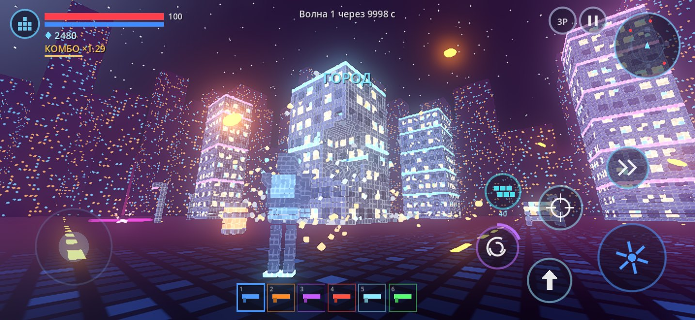
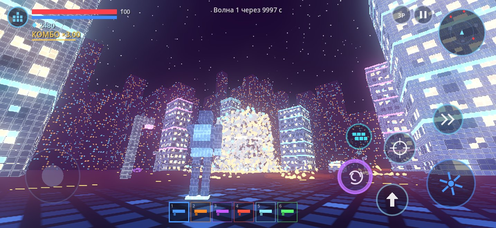
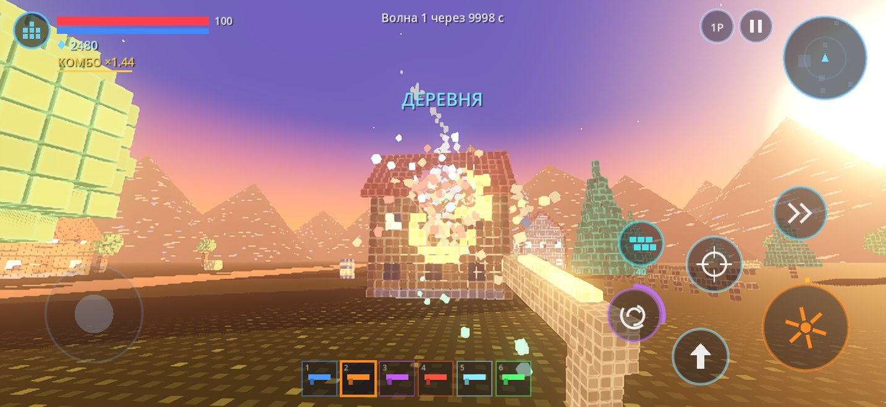
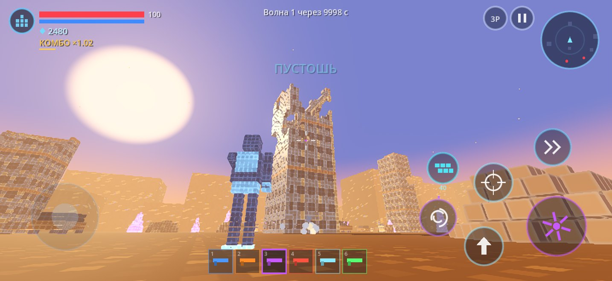
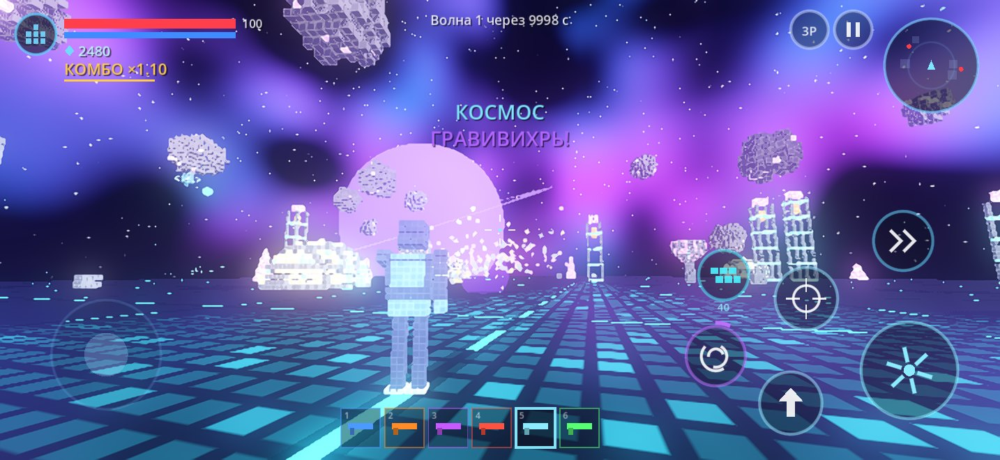
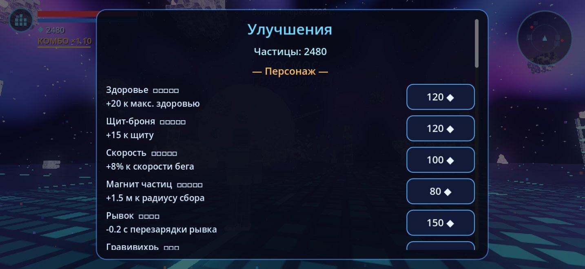

# Particle Strike

Мобильный 3D-шутер на Godot 4: весь мир, персонаж, враги и оружие собраны из частиц-вокселей, и всё это можно разрушить. Проект сделан для **Xogot** на iPhone, а оптимизация настроена под **iPhone 16 Pro Max**.

Ассетов нет: все модели, звуки, музыка, небо и земля генерируются кодом. Поэтому проект лёгкий и запускается без импорта ресурсов.

## Скриншоты (настоящий рендер игры, Mobile-рендерер Godot 4.4)

| | |
|---|---|
|  |  |
| Город: ракета по небоскрёбу | Обрушение: здание рассыпается на частицы |
|  |  |
| Деревня, вид от первого лица, дробовик | Пустошь: тоннель от лазера снайпера в руинах |
|  |  |
| Космос: астероиды, планета, гравивихрь | Магазин улучшений |

---

## Как запустить в Xogot (iPhone)

1. Скачайте архив `ParticleStrike.zip` и сохраните его в «Файлы» (например, в папку *Xogot* или *На iPhone*).
2. В приложении «Файлы» нажмите на архив, и iOS распакует его в папку `particle_strike`.
3. Откройте Xogot, нажмите **Open / Import Project** и выберите папку `particle_strike`, в которой лежит `project.godot`.
4. Дождитесь первичного импорта (несколько секунд) и нажмите **▶ Play**.

Вместо архива можно импортировать проект из GitHub (в Xogot это делается через импорт репозитория) и открыть подпапку `particle_strike`.

Проект совместим с Godot **4.4+**: рендер Mobile, только GDScript, без плагинов. Он откроется и в обычном Godot на компьютере.

---

## Управление

| Где | Что делает |
|---|---|
| Левая половина экрана | **Плавающий джойстик** появляется там, где коснулись, и «едет» за пальцем |
| Правая половина, свайп | Поворот камеры |
| **ОГОНЬ** (большая кнопка) | Стрельба, пока удерживаете. Не отпуская кнопку, можно вести прицел |
| **ПРИЦЕЛ** | Приближение (у снайпера — оптика), замедляет бег и повышает точность |
| **ПРЫЖОК** | Повторное нажатие в воздухе — двойной прыжок на реактивных частицах |
| **РЫВОК** | Короткий бросок с неуязвимостью |
| **ВИХРЬ** | Гравивихрь; кольцо вокруг кнопки показывает заряд |
| **СТЕНА** | Ставит перед вами укрытие из частиц, стоит 40 ◆ |
| Нижняя панель | Выбор из 6 видов оружия; полоска под иконкой — нагрев |
| **3P / 1P** | Вид от третьего или первого лица |
| **II** | Пауза: улучшения, настройки, выход |

Клавиатура (Xogot на iPad или ПК): WASD — ходьба, стрелки — обзор, Пробел — прыжок, Shift — рывок, Enter — огонь, R — прицел, 1–6 — оружие, Q — вихрь, E — стена, V — камера, Esc — пауза.

---

## Базовые механики (из исходного ТЗ)

- **Мир из частиц.** Здания, деревья, мосты, машины, камни, кристаллы, персонаж и враги состоят из тысяч светящихся частиц. Земля, вода и небо тоже нарисованы «пиксельными» частицами в шейдерах.
- **Полная разрушаемость.** Каждый выстрел выбивает частицы. Прочность зависит от материала: бетон, металл, стекло, дерево, лёд, кристаллы и т.д.
- **Оружие стреляет частицами** разных стихий: энергия, взрыв, лазер, лёд, плазма, огонь.
- **Сбор ресурсов.** Разрушенное рассыпается, часть частиц становится светящейся валютой ◆, которую магнитом притягивает к игроку.
- **Прогрессия.** Валюту тратят на улучшения персонажа и оружия.
- **6 видов оружия:**

| Оружие | Стихия | Особенность |
|---|---|---|
| Пистолет | энергия | цепная молния перескакивает на соседнего врага |
| Дробовик | взрывные | 8 взрывающихся дробин, поджигают дерево |
| Снайпер | лазер | прожигает тоннель в стенах и пробивает врагов насквозь |
| Ракетница | фрагменты | большой взрыв и 6 осколков со вторичными взрывами |
| Ледяное | заморозка | замораживает врагов и превращает стены в хрупкий лёд |
| Плазма | разрушение | медленная сфера проедает всё на своём пути |

- **4 локации:** ночной неоновый **Город**, закатная **Деревня** (река, арочный мост, церковь, дым из труб), пыльная **Пустошь** (руины, ржавые машины, кристаллы) и **Космос** (орбитальная платформа, парящие астероиды, планета с кольцами, **низкая гравитация**).
- **Минимальный интерфейс** и сенсорное управление (см. выше).

## 10 новых механик

1. **Структурное обрушение.** После каждого повреждения игра ищет частицы, которые больше не связаны с опорой. Если подбить низ небоскрёба, верх отрывается **целым куском**, падает как твёрдое тело и разбивается о землю.
2. **Каскадные разрушения.** Упавший кусок бьёт всё под собой: соседние постройки, врагов и игрока. Мост держится за оба берега и рушится, если перебить пролёт.
3. **Цепные реакции.** Красные частицы взрывоопасны: бочки, бензобаки машин, ядра космических пилонов. Один взрыв запускает следующий.
4. **Стихии и статусы.** Огонь распространяется по дереву, листве и сену и сжигает их. Лёд замораживает врагов: замороженные получают ×1.8 урона. Ледяные стены хрупкие и рассыпаются от любого удара. Горящие враги теряют здоровье со временем.
5. **Гравивихрь.** Ультимативная способность, которая заряжается от разрушений и убийств. Вихрь затягивает врагов и куски зданий, а затем схлопывается во взрыв.
6. **Стена из частиц.** За 40 ◆ можно поставить укрытие с анимацией сборки снизу вверх. Одновременно существует до 3 стен.
7. **Рывок и двойной прыжок.** Рывок даёт неуязвимость на время броска. Взрывы своих ракет не ранят, а подбрасывают, так что работает **ракетный прыжок**.
8. **Перегрев.** Вместо патронов у каждого оружия своя шкала нагрева. Если довести её до 100 %, ствол заблокируется до остывания. Для улучшения есть стат «Охлаждение».
9. **Комбо-множитель.** Быстрые разрушения и убийства поднимают множитель до ×3 к получаемым частицам.
10. **Волны врагов и боссы (выживание).** Есть 4 типа врагов:
    - **Рой** — быстрый, прыгает через препятствия;
    - **Стрелок** — держит дистанцию и стреляет на упреждение;
    - **Громила** — проламывает стены насквозь и бьёт ударной волной;
    - **Дрон** — кружит сверху и стреляет.

    Каждая 5-я волна — босс **Колосс** с веерной стрельбой. После 5 пройденных волн открывается следующая локация.

Дополнительно:
- щит восстанавливается через 4 с без урона;
- у снарядов игрока неконтактный взрыватель: ракета взрывается рядом с врагом, а пули прощают небольшой промах, так на сенсорном экране проще попадать;
- вибрация при попаданиях, взрывах и обрушениях;
- эмбиент-музыка для каждой локации и для меню;
- подсказки по управлению при первом запуске;
- зелёные частицы из врагов лечат;
- при крупных обрушениях включается **замедление времени**;
- сенсорную стрельбу облегчает **автоприцел** с мягким магнитом камеры;
- прогресс сохраняется автоматически.

## Анимации, коллизии, эффекты

- **Процедурные анимации персонажей:**
  - бег с покачиванием и наклоном;
  - поза в прыжке и сжатие при приземлении;
  - растяжение при рывке;
  - дыхание в покое;
  - рука с оружием следит за прицелом, есть отдача;
  - вспышка при попадании;
  - **распад на частицы** при смерти;
  - враги появляются, «собираясь» из частиц;
  - у паука своя анимация ног, у дрона вращаются кольца;
  - Громила замахивается обеими руками перед ударом.
- **Коллизии:**
  - каждый объект поделён на ячейки 4×4×4 частицы, и пустые ячейки отключаются, так что в пробитую дыру можно пройти;
  - попадания считаются лучом по сетке частиц (DDA), поэтому точны до одной частицы;
  - снаряды проверяются лучом между кадрами и не проходят сквозь стены;
  - персонаж поднимается на невысокие ступени;
  - камера на пружине не проходит сквозь стены.
- **Эффекты:**
  - вспышки и ударные кольца;
  - лучи лазера и молнии;
  - свет от взрывов;
  - тряска камеры;
  - дым из труб и частицы атмосферы (неоновые искры, светлячки, пыль, звёздная пыль);
  - процедурные звуки.

## Прогрессия

- **Валюта ◆ (частицы)** даётся за разрушения (с учётом материала и комбо), за убийства и бонусом за каждую пройденную волну.
- **Персонаж:** здоровье, щит, скорость, радиус магнита, перезарядка рывка, скорость заряда вихря.
- **Оружие:** открыть за ◆, затем 4 улучшения по 5 уровней (урон, радиус разрушения, темп, охлаждение).
- **Локации:** Город → Деревня → Пустошь → Космос. Следующая открывается после 5 волн на предыдущей. В настройках можно открыть все сразу.

---

## Оптимизация под iPhone 16 Pro Max

Целевое устройство: A18 Pro, 6-ядерный GPU, 8 ГБ ОЗУ, экран 2868×1320, ProMotion 120 Гц.

- **Рендер Mobile** (Metal): 3D рисуется в 82 % разрешения и растягивается до экрана, интерфейс остаётся чётким. Если Xogot работает на Godot 4.5+ с Metal, используется апскейл **MetalFX Spatial**, иначе — билинейный. FSR в Godot 4.4 доступен только в рендере Forward+, поэтому здесь не применяется.
- **Адаптивное разрешение.** Если кадр не укладывается в бюджет, 3D-разрешение снижается шагами по 5 % (минимум до 50 %), а при запасе возвращается. Это держит стабильные 60 FPS при нагреве телефона.
- **Один MultiMesh на объект.** Тысячи частиц рисуются одним draw call. Удаление частицы — запись нулевого масштаба, без пересборки меша.
- **Обломки считаются на GPU.** Полёт, отскок, скольжение, вращение и исчезновение вычисляются аналитически в вершинном шейдере. CPU пишет данные один раз при появлении, поэтому тысячи обломков почти ничего не стоят процессору.
- **Кольцевые буферы и пулы.** Обломки, частицы-ресурсы, снаряды, вспышки, лучи и свет создаются заранее. В бою нет выделений памяти и создания нод.
- **Коллизии без нод.** Ячейки создаются через `shape_owner` прямо в теле (сотни форм без накладных расходов на ноды). Обрушение проверяется не чаще 2 объектов за кадр.
- **Ограничение на событие.** Огромное обрушение превращается максимум в N обломков (N зависит от пресета), у которых увеличен размер. Падающих кусков одновременно не больше 6.
- **Дешёвое освещение:**
  - одно направленное солнце, ортогональные тени только на 45 м и только от крупных зданий;
  - эмиссия и glow вместо десятков ламп;
  - небо без `TIME`, поэтому карта отражений считается один раз (64 px);
  - дальний фон (небоскрёбы, горы) — один общий меш.
- **LOD / дальность.** Мелкие объекты скрываются по `visibility_range`, туман маскирует границу, узор земли гаснет с расстоянием (без муара).
- **Безопасная зона.** Кнопки не залезают под Dynamic Island и полоску «домой».
- **Пресеты** «Низкое / Среднее / Высокое / Ультра» и режим **120 FPS** для ProMotion. По умолчанию 60 FPS: так телефон меньше греется и держит частоту дольше.
- **Батарея.** При сворачивании приложения игра ставится на паузу и сохраняется.
- **Без рывков в бою.** Музыка генерируется на экране загрузки.

---

## Структура проекта

```
particle_strike/
├── project.godot              — настройки (Mobile-рендер, ландшафт, автозагрузки)
├── main.tscn                  — единственная сцена, всё остальное строится кодом
├── icon.svg
├── shaders/
│   ├── voxel.gdshader         — частица-воксель: свечение рёбер, мерцание, вспышка/заморозка
│   ├── debris.gdshader        — обломки с физикой на GPU
│   ├── ground.gdshader        — земля из частиц + дороги
│   ├── water.gdshader         — мерцающая вода
│   ├── sky.gdshader           — небо: градиент, солнце, звёзды, туманность
│   └── backdrop.gdshader      — дальний фон с окнами/пикселями
└── scripts/
    ├── autoload/
    │   ├── game_state.gd      — валюта, улучшения, локации, настройки, сохранение
    │   ├── perf.gd            — пресеты качества, апскейл, адаптивное разрешение, 60/120 FPS
    │   └── sfx.gd             — синтезированные звуки, музыка, вибрация
    ├── data/
    │   └── weapon_data.gd     — характеристики 6 видов оружия
    ├── core/
    │   ├── main.gd            — меню → загрузка → игра → пауза/поражение
    │   ├── game_world.gd      — корень мира: взрывы, комбо, вихрь, стены, награды, замедление
    │   ├── voxel_mat.gd       — материалы частиц (цвет, прочность, горючесть, взрывоопасность)
    │   ├── voxel_object.gd    — разрушаемый объект: сетка, DDA-лучи, урон, горение, обрушение
    │   ├── falling_chunk.gd   — оторвавшийся кусок здания (твёрдое тело)
    │   ├── voxel_shapes.gd    — генераторы: небоскрёб, дом, церковь, дерево, мост, машина, руины…
    │   ├── level_env.gd       — небо, свет, туман, земля, границы, дальний фон, атмосфера
    │   ├── level_builder.gd   — сборка 4 локаций
    │   ├── debris_system.gd   — обломки (кольцевой буфер)
    │   ├── shard_system.gd    — собираемые частицы и лечение
    │   ├── fx_system.gd       — вспышки, кольца, лучи, молнии, свет
    │   ├── projectile_system.gd — снаряды, лазер, плазма, осколки, цепная молния
    │   ├── voxel_rig.gd       — модели из частиц и процедурные анимации
    │   └── wave_director.gd   — волны, боссы, награды, открытие локаций
    ├── player/
    │   └── player.gd          — движение, камера 1P/3P, оружие, перегрев, рывок, автоприцел
    ├── enemies/
    │   └── enemy.gd           — 5 типов врагов и их ИИ, статусы
    └── ui/
        ├── touch_controls.gd  — мультитач: джойстик, обзор, кнопки, панель оружия
        ├── hud.gd             — HUD: здоровье, щит, частицы, комбо, миникарта, прицел
        └── menus.gd           — меню, локации, улучшения, настройки, пауза, поражение
```

## Как проект проверялся

Проект прогнан в настоящем движке **Godot 4.4.1**:

- **Автотест всех 4 локаций (headless).** В каждой локации проверены загрузка, стрельба из всех 6 видов оружия, прыжок, двойной прыжок, рывок, стена, гравивихрь, смена камеры и прицел, обрушение самого высокого здания, первая волна врагов (зачищена полностью во всех локациях), пауза, смерть игрока, экран поражения и выход в меню. Ошибок скриптов нет.
- **Отдельный тест урона.** Каждое оружие стреляет по врагу в каждой локации. Тест нашёл баг (ракета пролетала мимо стрейфящего врага), он исправлен неконтактным взрывателем.
- **Рендер в Mobile-рендерере (Vulkan).** Все шейдеры компилируются, скриншоты выше сняты из игры.
- **Производительность CPU** (настольный процессор, без учёта видеокарты):
  - загрузка локации 0,1–0,4 с;
  - средний кадр игровой логики ≈1 мс;
  - единичные пики до ~20 мс в момент обрушения большого здания (прикрыты замедлением времени).

**Не проверено** на самом iPhone и внутри Xogot. Если Xogot покажет ошибку в Output, пришлите её текст.

120 FPS работают, только если Xogot разрешает ProMotion для запускаемых проектов. Иначе игра остаётся на 60 FPS.
